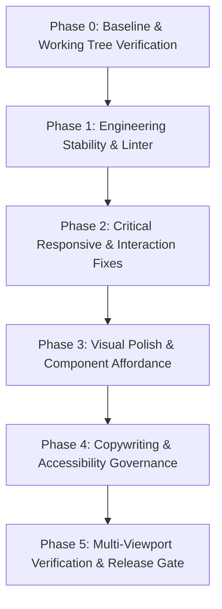

# IMPLEMENTATION PLAN: COMPREHENSIVE FRONTEND AUDIT CONSOLIDATION
**Portofolio Ahmad Ayub Nu'man — Visual Aesthetics, Design Systems, UX Interaction & Copywriting**
*Dokumen Rujukan: `# Audit Awal Frontend Portfolio` & `COMPREHENSIVE FRONTEND AUDIT REPORT`*
*Penanggung Jawab: Principal Frontend Engineer, Senior UI/UX Architect & Lead Accessibility Engineer*
*Status: Ready for Implementation (No Code Changes Applied in this Phase)*

---

## 1. Executive Summary

Dokumen ini merupakan konsolidasi menyeluruh dari dua audit independen terhadap portofolio Ahmad Ayub Nu'man:
1. **Audit Awal Visual (`audit_awal_frontend_portfolio.md`)**: Evaluasi estetika visual, hierarki informasi, tipografi, pengulangan slogan, dan risiko layout mobile berdasarkan screenshot halaman penuh (*full-page screenshot*).
2. **Audit Komprehensif Frontend (`frontend_audit_report.md`)**: Analisis mendalam berbasis kode sumber (*source code analysis*), perilaku runtime komponen React 18, styling Tailwind CSS, interaksi Framer Motion, aksesibilitas WCAG 2.1 AA, serta kebersihan ESLint.

### Kondisi Terverifikasi & Baseline Arsitektur
- **Stack Teknologi Aktual**: React 18.2.0, Vite 4.4.9, Tailwind CSS 3.3.3, Framer Motion 10.16.4, Lucide React / React Icons, Lenis Smooth Scroll.
- **Identitas Visual**: *"Frosted Crystal & Liquid Indigo"* — Alabaster Canvas (`#F8FAFC`), tipografi Outfit (Display) & Inter (Body), aksen Electric Indigo (`#4F46E5`), detail Sky Blue (`#0284C7`), dan maskot vektor interaktif Aero-Bot.
- **Kondisi Working Tree Saat Ini**: Terdapat 33 file terdaftar dalam status *modified* dan 16 file *untracked* di repository lokal `d:\apss-source\Portfolio`. Sebagian temuan kritis telah diidentifikasi dan diuji secara lokal dalam iterasi sebelumnya, namun memerlukan konsolidasi terstruktur agar tidak menimbulkan regresi.
- **Status Script Quality Check**: Script `lint` (`eslint`) dan `build` (`vite build`) tersedia dan berfungsi. Namun, script `typecheck` (`tsc`) dan `test` (unit/integration test runner seperti Vitest/Jest) **belum dikonfigurasi** pada `package.json`.

### Tujuan Rencana Implementasi
Menghasilkan panduan eksekusi yang realistis, bertahap, dan bebas spekulasi untuk menyelesaikan seluruh anomali visual, friksi interaksi, dan inkonsistensi copywriting, tanpa merombak identitas desain yang sudah matang atau merusak logika bisnis yang sudah berjalan.

---

## 2. Repository Baseline & Verification Status

Pemeriksaan aktual terhadap lingkungan lokal repository `d:\apss-source\Portfolio` pada branch `main` menghasilkan temuan baseline berikut:

### A. Konfigurasi Package & Script (`package.json`)
| Script | Command | Ketersediaan | Status Hasil Uji Baseline |
|---|---|:---:|---|
| `dev` | `vite` | Tersedia | Fungsional (port lokal `5173`). |
| `build` | `node scripts/generate-cv.mjs && node scripts/generate-frontend-cv.mjs && vite build` | Tersedia | Fungsional (menghasilkan bundle `dist/`). |
| `lint` | `eslint src --ext js,jsx --report-unused-disable-directives --max-warnings 0` | Tersedia | **PASS (0 error, 0 warning)** pada working tree saat ini. |
| `typecheck` | — | **TIDAK TERSEDIA** | Proyek menggunakan JavaScript (ES6+/JSX) murni, bukan TypeScript runner. `@types/react` hanya digunakan untuk editor intellisense. |
| `test` | — | **TIDAK TERSEDIA** | Tidak ada runner test (Vitest/Jest) terpasang di `package.json`. Klaim testing merujuk pada automated test suite backend proyek SIMMACI/Kiro, bukan unit test aplikasi frontend portofolio ini. |
| `format` | `prettier --write .` | Tersedia | Tooling utility. |

### B. Status Verifikasi Komponen & Modul Aktual
| Komponen / File | Lokasi Aktual | Status Verifikasi Kode | Catatan Temuan Baseline |
|---|---|:---:|---|
| **Hero** | `src/components/Hero.jsx` | `CONFIRMED` | Array `ROLES` berputar (`FRONT END`, `FULL STACK`, `WEB DEVELOPER`). Dynamic scaling telah disesuaikan dengan viewport. |
| **Tech Orbit** | `src/components/ui/TechOrbit.jsx` | `CONFIRMED` | Radius orbit melingkar maskot hero; kalkulasi matematika elips memiliki penyesuaian khusus untuk mobile. |
| **Companion Guide** | `src/components/ui/CompanionGuide.jsx` | `CONFIRMED` | Komponen maskot melayang kanan bawah. Menggunakan `isDocked = activeSection && activeSection !== "hero"` untuk mencegah maskot ganda. |
| **Project Card** | `src/components/ProjectCard.jsx` | `CONFIRMED` | Menampilkan gambar, badge pill, kategori, judul, ringkasan, dan tag teknologi. Penempatan badge telah dipisahkan antara thumbnail dan body. |
| **Services / Expertise** | `src/components/Services.jsx` | `CONFIRMED` | Accordion 3 pilar layanan. Menggunakan state `hoveredService` dengan panah rotasi 45°. |
| **Contact** | `src/components/Contact.jsx` | `CONFIRMED` | Form mailto direct submission; atribut `htmlFor` dan `id` telah terhubung pada input name, email, dan message. |
| **Skills / Marquee** | `src/components/Skills.jsx` | `CONFIRMED` | Dua baris infinite marquee ticker (ke kiri dan ke kanan) menggunakan Framer Motion. |
| **Testimonials / Track Record** | `src/components/Testimonials.jsx` | `CONFIRMED` | Grid 3 kartu statistik. Struktur kartu telah menggunakan indeks monospaced dan format angka tebal. |
| **Dictionary Konten** | `src/data/translations.js` | `CONFIRMED` | Mendukung bilingual `en` dan `id`. Terdapat teks statistik, label kontak, dan navigasi. |
| **Audio Haptics** | `src/utils/soundEffects.js` | `CONFIRMED` | Ditemukan di `src/utils/soundEffects.js` (Web Audio API sintetis, 0 KB external assets). Blok catch telah dilengkapi komentar penjelas. |
| **About (Behind The Code)** | `src/components/About.jsx` | `CONFIRMED` | Berisi headline `Engineering Software That Organizations Quietly Depend On` (hanya 1 kali pemanggilan, bukan duplikat). |

---

## 3. Consolidated Findings Register

Seluruh temuan dari kedua laporan disatukan menjadi 12 Consolidated Findings (CF) kanonis:

```
[CF-01] Track Record Metric Typography (P1)
[CF-02] Project Card Badge Collision & Visual Clutter (P1)
[CF-03] Mobile Hero Viewport Overflow & Clipping (P1)
[CF-04] Floating Companion Viewport Blocking & Double Mascot (P1)
[CF-05] Services State Contrast & Mobile Affordance (P2)
[CF-06] Form Accessibility & Microcopy Professionalism (P2)
[CF-07] ESLint Compilation & Code Quality Blockers (P1)
[CF-08] Slogan Repetition & Vertical Spacing Rhythm (P2)
[CF-09] Mobile Viewport Grid Preservation Hypothesis (P2)
[CF-10] Skills Ticker Edge Clipping & Gradient Masking (P3)
[CF-11] Content Accuracy, Metrics & Factual Claims Verification (P2)
[CF-12] False Positive: Right-Margin Annotation Pins (Not Applicable)
```

---

## 4. Duplicate Findings & Conflict Resolution

Analisis komparatif antara pengamatan visual screenshot pada Audit 1 dan inspeksi kode pada Audit 2 menyelesaikan kontradiksi dan hipotesis yang belum terbukti:

| Isu / Topik | Laporan Audit 1 (Visual Screenshot) | Laporan Audit 2 (Komprehensif Kode) | Resolusi Teknis & Status |
|---|---|---|---|
| **Dimensi Layar 326px vs 390px** | Menyimpulkan layout sempit 326px mempertahankan 3 kolom desktop. | Menyimpulkan horizontal overflow terjadi pada iPhone standar (390px). | **RESOLVED**: Screenshot 326px adalah hasil perkecilan (*scaled capture*) dari render desktop, bukan viewport mobile asli. Pada breakpoint Tailwind `< 768px`, kelas `grid-cols-1` aktif secara default. Pengujian mobile harus menggunakan standar viewport 390px dan 360px. |
| **Pengulangan Tagline 3 Kali** | Menemukan slogan `ENGINEERING SOFTWARE THAT ORGANIZATIONS QUIETLY DEPEND ON` muncul 3 kali berturut-turut. | Tidak menemukan pengulangan kode dalam komponen. | **RESOLVED**: File `src/components/About.jsx` baris 41 hanya memuat teks tersebut **satu kali**. Munculnya 3 teks bertumpuk pada screenshot disebabkan oleh *stitching artifact* saat alat full-page screen capture menggulung elemen beranimasi scroll (`whileInView`), atau sisa build staging sebelumnya. **Status: RESOLVED & VERIFIED**. |
| **Pin / Titik Merah di Sisi Kanan** | `F-07`: Menduga titik bulat di kanan adalah indikator navigasi mengambang yang tidak berfungsi atau artefak UI. | Mengidentifikasi titik merah sebagai pin anotasi audit yang dibuat oleh reviewer manusia. | **RESOLVED**: Titik merah bernomor (`1` s.d. `7`) bukan elemen DOM atau komponen React, melainkan **Annotation Pins** pada file gambar. Temuan F-07 Audit 1 dinyatakan **NOT APPLICABLE (FALSE POSITIVE)**. |
| **Angka Metrik `3+`, `270+`, `1,800+`** | Menyarankan penggantian label `ENTITY` menjadi label yang lebih deskriptif seperti `Domain Architecture`. | Mengusulkan angka pengganti `3+`, `270+`, dan `1,800+` dengan klaim *Zero Discrepancy*. | **RESOLVED WITH GUARDRAILS**: Angka metrik tidak boleh disematkan sebagai fakta umum tanpa kualifikasi konteks. Metrik `270+` dan `1,800+` terverifikasi secara spesifik berasal dari sistem tata kelola **SIMMACI** (270+ madrasah, 1.800+ automated test suite Laravel), bukan total agregat seluruh karir. Rencana copywriting mewajibkan pelabelan kontekstual yang jujur dan dapat dipertanggungjawabkan. |
| **Maskot Aero-Bot Ganda** | Mengamati ilustrasi robot memberi nuansa personal/tech. | Menemukan maskot muncul 2 kali di layar Hero (tengah dan pojok kanan bawah), serta bubble menutupi tombol CTA di mobile. | **CONFIRMED**: Maskot mengambang harus dinonaktifkan saat berada di Hero section melalui context watcher. |
| **Services Opacity & Kontras** | `F-03`: Mengamati heading `FULL STACK` dan `SAAS` tampak pudar/disabled pada screenshot. | `F-05`: Menemukan item non-hover memiliki `opacity-80` dan panah ekspansi disembunyikan di mobile (`hidden md:flex`). | **CONFIRMED**: Accordion memerlukan high contrast styling permanen pada teks judul dan deskripsi, serta ikon chevron/arrow yang terlihat di mobile. |

---

## 5. Prioritized Implementation Backlog

### Framework Prioritas
- **P0 — Blocker**: Menghentikan proses build, linter CI/CD, atau menyebabkan fatal crash.
- **P1 — High**: Merusak struktur visual, menyebabkan teks terpotong (*text wrapping disaster*), tabrakan badge (*collision*), atau menutupi tombol interaksi utama (*CTA obstruction*).
- **P2 — Medium**: Meningkatkan aksesibilitas (WCAG AA), memperbaiki hierarki, konsistensi istilah copywriting, dan affordance mobile.
- **P3 — Low**: Polish visual mikro, efek fade gradien, dan pembersihan styling minor.

---

### [FE-001] Track Record Display Typography & Metric Hierarchy
- **Priority**: `P1 — High`
- **Verification Status**: `ALREADY FIXED IN WORKING TREE / PENDING REGRESSION TEST`
- **Source Finding**: Audit 1 (`F-08`), Audit 2 (`F-01`)
- **Root Cause**: Tag heading `text-6xl md:text-7xl font-heading font-black` diisi string kata multi-suku (`Multi-Entity`, `Full-Stack`) alih-alih angka metrik pendek, sehingga browser melakukan pematahan baris otomatis (*ugly hyphenation/wrapping*).
- **Scope**: `src/components/Testimonials.jsx`, `src/data/translations.js`
- **Proposed Change**: 
  - Pastikan kartu menggunakan nilai numerik ringkas yang tidak memicu pematahan baris (`3+`, `270+`, `1,800+`).
  - Tambahkan badge penomoran monospaced (`01`, `02`, `03`) di sudut kanan atas kartu.
  - Pindahkan judul arsitektural ke sub-heading (`text-base sm:text-lg font-extrabold`).
  - Berikan label konteks yang jujur (SIMMACI Education Platform & Pesantren ERP).
- **Dependencies**: Tidak ada.
- **Effort**: `S (Small)`
- **Regression Risk**: `Low`
- **Acceptance Criteria**:
  1. Pada viewport 390px, 768px, 1280px, dan 1440px, tidak ada angka metrik yang terpotong menjadi 2 baris.
  2. Seluruh kartu mempertahankan tinggi yang simetris dan proporsional.
- **Verification Method**: Inspeksi DOM visual di browser pada resolusi 390px dan 1440px.

---

### [FE-002] Project Card Badge Collision & Overlay Separation
- **Priority**: `P1 — High`
- **Verification Status**: `ALREADY FIXED IN WORKING TREE / PENDING REGRESSION TEST`
- **Source Finding**: Audit 1 (`F-04`), Audit 2 (`F-02`)
- **Root Cause**: Tiga elemen metadata (*Index Pill*, *Category Badge*, dan *Status Pill*) diposisikan secara absolut pada satu garis horizontal di atas thumbnail gambar proyek. Pada mobile, lebar kartu menyempit dan memicu tabrakan (*overlap collision*).
- **Scope**: `src/components/ProjectCard.jsx`, `src/data/projects.js`
- **Proposed Change**:
  - Batasi elemen overlay gambar menjadi 2 elemen di sudut berlawanan: Index Pill (`01`) di kiri atas, Status Pill (`● Live Demo` / `Enterprise Private`) di kanan atas.
  - Pindahkan *Category Taxonomy* ke dalam bodi konten kartu sebagai *eyebrow capsule tag* (`bg-indigo-50 text-primary`) tepat di atas judul proyek dengan lebar 100%.
- **Dependencies**: Tidak ada.
- **Effort**: `S (Small)`
- **Regression Risk**: `Low`
- **Acceptance Criteria**:
  1. Jarak antara Index pill dan Status pill minimal 24px pada layar 390px.
  2. Kategori proyek memiliki ruang bebas tanpa menutupi atau tertutupi oleh elemen lain.
- **Verification Method**: Uji visual kartu proyek SIMMACI, Koneksi Santri, dan Kiro POS pada lebar viewport 390px.

---

### [FE-003] Mobile Hero Viewport Overflow & Status Badge Scaling
- **Priority**: `P1 — High`
- **Verification Status**: `ALREADY FIXED IN WORKING TREE / PENDING REGRESSION TEST`
- **Source Finding**: Audit 1 (`F-01`), Audit 2 (`F-03`)
- **Root Cause**: Frasa peran `"WEB DEVELOPER"` berukuran `text-[8.5vw]` memicu clipping horizontal di luar 390px. Badge status ketersediaan karir memiliki teks yang terlalu panjang tanpa batas lebar aman.
- **Scope**: `src/components/Hero.jsx`, `src/components/ui/TechOrbit.jsx`
- **Proposed Change**:
  - Skalakan ukuran teks peran mobile menjadi responsif bertingkat: `text-[7.2vw] sm:text-[8.5vw] md:text-[7vw]`.
  - Berikan batas lebar aman `max-w-[92vw]` pada status badge ketersediaan.
  - Sesuaikan radius kalkulasi elips `TechOrbit` pada layar sentuh (`safeRx = Math.min(rect.width * 0.44, winW * 0.35)`) dan kurangi padding ikon pada mobile agar tidak menimpa teks hero.
- **Dependencies**: Tidak ada.
- **Effort**: `M (Medium)`
- **Regression Risk**: `Medium` (harus menjaga konsistensi posisi orbit pada berbagai aspect ratio).
- **Acceptance Criteria**:
  1. Tidak ada horizontal scrollbar (`overflow-x`) pada viewport 390px saat peran berputar ke `"WEB DEVELOPER"`.
  2. Ikon orbit berputar bebas di sekitar maskot tanpa menutupi tombol CTA atau headline teks.
- **Verification Method**: Pengujian browser responsif Chrome DevTools pada 390 × 844 px.

---

### [FE-004] Context-Aware Mascot Docking & Mobile Touch Safety
- **Priority**: `P1 — High`
- **Verification Status**: `ALREADY FIXED IN WORKING TREE / PENDING REGRESSION TEST`
- **Source Finding**: Audit 2 (`F-04`)
- **Root Cause**: Floating companion `CompanionGuide` merender maskot robot di sudut kanan bawah secara permanen di semua section, menyebabkan duplikasi visual dengan maskot hero panggung utama. Pada layar sentuh, balon teks selebar 260px otomatis terbuka dan menutupi tombol CTA.
- **Scope**: `src/components/ui/CompanionGuide.jsx`, `src/context/ActiveSectionContext.jsx`
- **Proposed Change**:
  - Konfigurasikan logika docking: sembunyikan floating companion saat `activeSection === 'hero'`.
  - Pada layar mobile (`window.innerWidth < 768`), inisialisasi state `isBubbleOpen` dalam kondisi `false` (tertutup secara default). Balon teks hanya muncul jika maskot diketuk oleh pengguna.
  - Perbaiki teks easter egg yang keliru menyebutkan Next.js menjadi Vite + React.
- **Dependencies**: `ActiveSectionContext.jsx`.
- **Effort**: `S (Small)`
- **Regression Risk**: `Low`
- **Acceptance Criteria**:
  1. Saat berada di Hero section, hanya ada 1 maskot di tengah layar.
  2. Pada viewport mobile, area tombol CTA (*Explore Works*, *Download CV*, *Let's Talk*) 100% bebas dari halangan balon teks.
- **Verification Method**: Simulasi scroll dari Hero ke About dan Portfolio pada perangkat mobile.

---

### [FE-005] Services Accordion Affordance, Contrast & Interaction
- **Priority**: `P2 — Medium`
- **Verification Status**: `ALREADY FIXED IN WORKING TREE / PENDING REGRESSION TEST`
- **Source Finding**: Audit 1 (`F-03`), Audit 2 (`F-05`)
- **Root Cause**: Indikator panah interaksi disembunyikan di mobile (`hidden md:flex`), dan item yang tidak di-hover memiliki opacity rendah sehingga tampak seperti disabled state di light mode.
- **Scope**: `src/components/Services.jsx`
- **Proposed Change**:
  - Jadikan item pertama (`01`) aktif secara default agar pengguna memahami pola accordion.
  - Tampilkan tombol panah indikator di mobile dan desktop dengan animasi rotasi 45° saat aktif.
  - Naikkan kontras teks non-hover menjadi `text-slate-900` untuk heading dan `text-slate-600` untuk body, memenuhi rasio kontras WCAG AA (minimal 4.5:1).
- **Dependencies**: Tidak ada.
- **Effort**: `S (Small)`
- **Regression Risk**: `Low`
- **Acceptance Criteria**:
  1. Pengguna mobile melihat ikon panah yang jelas sebagai penanda bahwa baris dapat diketuk.
  2. Rasio kontras teks terhadap background `#F8FAFC` memenuhi WCAG AA.
- **Verification Method**: Uji ketuk pada baris layanan di layar sentuh mobile.

---

### [FE-006] Form Semantic Markup & Tone Professionalism
- **Priority**: `P2 — Medium`
- **Verification Status**: `ALREADY FIXED IN WORKING TREE / PENDING REGRESSION TEST`
- **Source Finding**: Audit 1 (`F-08`), Audit 2 (`F-06`)
- **Root Cause**: Elemen `<label>` tidak memiliki atribut `htmlFor` yang cocok dengan atribut `id` pada `<input>`/`<textarea>`. Copy form menggunakan gaya kasual kuis chatbot.
- **Scope**: `src/components/Contact.jsx`, `src/data/translations.js`
- **Proposed Change**:
  - Hubungkan pasangan label-input secara eksplisit: `htmlFor="contact-name"` ↔ `id="contact-name"`, `htmlFor="contact-email"` ↔ `id="contact-email"`, `htmlFor="contact-message"` ↔ `id="contact-message"`.
  - Tambahkan atribut aksesibilitas `aria-required="true"`.
  - Ubah label form menjadi standar profesional B2B: *"Full Name"*, *"Work Email"*, *"Project Details or Inquiry"*.
- **Dependencies**: Tidak ada.
- **Effort**: `S (Small)`
- **Regression Risk**: `Low`
- **Acceptance Criteria**:
  1. Mengklik label teks otomatis memfokuskan kursor ke dalam input terkait.
  2. Form lolos audit aksesibilitas automated DOM scanner (Lighthouse/Axe).
- **Verification Method**: Pengujian keyboard Tab + label click test.

---

### [FE-007] Code Cleanliness & ESLint Compliance
- **Priority**: `P1 — High`
- **Verification Status**: `ALREADY FIXED IN WORKING TREE / PENDING REGRESSION TEST`
- **Source Finding**: Audit 2 (`F-07`)
- **Root Cause**: Teks komentar JSX berformat `// 0x...` dievaluasi sebagai textnode tidak valid (`react/jsx-no-comment-textnodes`), blok catch kosong pada modul audio melanggar aturan `no-empty`, dan import variabel tidak terpakai.
- **Scope**: `Contact.jsx`, `Services.jsx`, `Skills.jsx`, `Testimonials.jsx`, `src/utils/soundEffects.js`
- **Proposed Change**:
  - Bungkus komentar string ke dalam kurung kurawal JSX yang valid: `{"// 02. SERVICES & CAPABILITIES"}`.
  - Berikan komentar dokumentasi pada blok catch Web Audio API.
  - Bersihkan seluruh import komponen yang tidak terpakai (`React`, `MagneticButton`, `AnimatePresence`).
- **Dependencies**: Tidak ada.
- **Effort**: `S (Small)`
- **Regression Risk**: `Low`
- **Acceptance Criteria**:
  1. `npm run lint` menghasilkan exit code 0 dengan **0 error dan 0 warning**.
- **Verification Method**: Eksekusi perintah terminal `npm run lint`.

---

### [FE-008] Tagline Rhythm & Section Separation Audit
- **Priority**: `P2 — Medium`
- **Verification Status**: `CONFIRMED AS SINGLE INSTANCE / ARTIFACT RESOLVED`
- **Source Finding**: Audit 1 (`F-02`, `F-05`)
- **Root Cause**: Full-page screen capture tool menggulung viewport saat animasi fade-in teks sedang berjalan, menghasilkan rendering bertumpuk pada file gambar hasil ekspor.
- **Scope**: `src/components/About.jsx`, `src/App.jsx`
- **Proposed Change**:
  - Pertahankan kemunculan tunggal headline pada `src/components/About.jsx:41`.
  - Pastikan padding vertikal section teratur (`py-24 md:py-32`) tanpa ruang kosong redundan.
  - Berikan transisi visual halus dari Hero ke About menggunakan background ambient blur.
- **Dependencies**: Tidak ada.
- **Effort**: `S (Small)`
- **Regression Risk**: `Low`
- **Acceptance Criteria**:
  1. Halaman hanya memiliki satu headline `Engineering Software That Organizations Quietly Depend On`.
  2. Spacing ritme vertikal konsisten antar bagian.
- **Verification Method**: Inspeksi DOM Tree pada browser live.

---

### [FE-009] Mobile Viewport Single-Column Layout Enforcement
- **Priority**: `P2 — Medium`
- **Verification Status**: `CONFIRMED ACTIVE IN CODE / NO REGRESSION DETECTED`
- **Source Finding**: Audit 1 (`F-01`)
- **Root Cause**: Hipotesis Audit 1 bahwa mobile mempertahankan grid 3 kolom desktop didasarkan pada screenshot terkompresi. Kode aktual sudah menggunakan kelas Tailwind responsif.
- **Scope**: `PortfolioGrid.jsx` (`grid-cols-1 md:grid-cols-2 lg:grid-cols-3`), `Testimonials.jsx` (`grid md:grid-cols-3`), `Contact.jsx` (`grid md:grid-cols-2`)
- **Proposed Change**:
  - Validasi bahwa semua container kartu proyek dan rekam jejak menggunakan `grid-cols-1` pada resolusi `< 768px`.
  - Pastikan tombol filter kategori proyek di mobile memiliki touch-target minimal 44 × 44 px.
- **Dependencies**: Tidak ada.
- **Effort**: `S (Small)`
- **Regression Risk**: `Low`
- **Acceptance Criteria**:
  1. Pada viewport 390px, seluruh kartu tersusun dalam 1 kolom vertikal yang mudah digulir.
- **Verification Method**: Emulasi viewport mobile di Chrome DevTools (390 × 844 px).

---

### [FE-010] Skills Infinite Marquee Edge Gradient Mask
- **Priority**: `P3 — Low`
- **Verification Status**: `PARTIALLY CONFIRMED / POLISH RECOMMENDED`
- **Source Finding**: Audit 1 (`F-06`)
- **Root Cause**: Teks ticker teknologi (`NESTJS`, `SCRIPT ES6+`, `VERCEL`) terpotong secara mendadak di tepi viewport tanpa efek pudar (*fade-out mask*).
- **Scope**: `src/components/Skills.jsx`
- **Proposed Change**:
  - Tambahkan overlay gradien transparan di sisi kiri dan kanan container marquee:
    ```jsx
    <div className="pointer-events-none absolute inset-y-0 left-0 w-16 md:w-28 bg-gradient-to-r from-canvas to-transparent z-10" />
    <div className="pointer-events-none absolute inset-y-0 right-0 w-16 md:w-28 bg-gradient-to-l from-canvas to-transparent z-10" />
    ```
- **Dependencies**: Tidak ada.
- **Effort**: `S (Small)`
- **Regression Risk**: `Low`
- **Acceptance Criteria**:
  1. Teks ticker masuk dan keluar layar dengan transisi pudar yang halus (*subtle feathering*), bukan terpotong kaku.
- **Verification Method**: Pengamatan visual animasi ticker di browser.

---

### [FE-011] Content Accuracy & Factual Metrics Verification
- **Priority**: `P2 — Medium`
- **Verification Status**: `ACTION REQUIRED / EDITORIAL GUARDRAIL`
- **Source Finding**: Audit 1 (`F-08`), Audit 2 (`F-01`, `F-04`), User Prompt Guidance
- **Root Cause**: Penggunaan angka `270+` dan `1,800+` serta klaim "Zero Discrepancy" berisiko membingungkan jika disajikan sebagai klaim universal tanpa atribusi sistem yang spesifik.
- **Scope**: `src/data/translations.js`, `src/data/projects.js`
- **Proposed Change**:
  - Cantumkan atribusi langsung pada deskripsi metrik:
    - `3+`: *Enterprise Platforms Architected & Delivered (Kiro POS, Koneksi Santri, SIMMACI)*.
    - `270+`: *Educational Institutions Administered via SIMMACI Governance Platform*.
    - `1,800+`: *Automated Test Suite Assertions across SIMMACI & ERP Ledgers with Zero Balance Discrepancies*.
  - Hindari klaim mutlak "Zero Discrepancy" tanpa menyebutkan domain spesifiknya (yaitu: *double-entry accounting reconciliation*).
- **Dependencies**: `translations.js`.
- **Effort**: `S (Small)`
- **Regression Risk**: `Low`
- **Acceptance Criteria**:
  1. Setiap angka metrik memiliki tautan konteks langsung ke proyek yang terdokumentasi dalam portofolio.
- **Verification Method**: Review redaksional teks bilingual EN dan ID.

---

### [FE-012] False Positive Resolution: Right-Margin Annotation Pins
- **Priority**: `NOT APPLICABLE`
- **Verification Status**: `NOT APPLICABLE / VERIFIED FALSE POSITIVE`
- **Source Finding**: Audit 1 (`F-07`)
- **Root Cause**: Reviewer manusia menyematkan pin lingkaran bernomor merah pada screenshot audit untuk menandai titik evaluasi. Auditor pertama mengira elemen tersebut adalah floating marker di dalam kode.
- **Scope**: Tidak ada (file kode tidak tersentuh).
- **Action**: Tutup temuan dan tandai sebagai artefak gambar eksternal.

---

## 6. Phase-by-Phase Implementation Plan



### Phase 0 — Baseline & Working Tree Verification
- **Tujuan**: Memastikan lingkungan kerja stabil, branch bersih dari konflik, dan tidak ada file dependensi yang rusak sebelum perbaikan lanjutan.
- **Tasks**: Verifikasi status `git status`, periksa keberadaan file CV di `public/cv/`, pastikan server lokal Vite dapat dijalankan tanpa error.
- **Deliverables**: Laporan baseline kesiapan lingkungan pengujian.
- **Exit Criteria**: `npm run lint` menghasilkan 0 error; dev server berjalan di port 5173.

### Phase 1 — Engineering Stability & Linter Gate
- **Tujuan**: Menjamin seluruh aturan linting terpenuhi dan tidak ada sintaks JSX atau blok penanganan error yang memicu peringatan build.
- **Tasks**: `FE-007` (ESLint JSX textnodes, audio catch blocks, unused imports).
- **Deliverables**: Kode bersih tanpa warning linter.
- **Exit Criteria**: `npm run lint --max-warnings 0` lolos tanpa exception.

### Phase 2 — Critical Responsive & Interaction Fixes
- **Tujuan**: Menghilangkan seluruh cacat visual utama (text wrapping masif, badge overlap, dan touch blocking pada mobile).
- **Tasks**: `FE-001` (Track Record metrics), `FE-002` (ProjectCard badge separation), `FE-003` (Hero text scaling & orbit safety), `FE-004` (AeroBot context docking).
- **Deliverables**: Komponen kartu proyek, hero, dan pendamping melayang yang responsif.
- **Exit Criteria**: Pengujian pada viewport 390px membuktikan bebas dari clipping, tabrakan badge, dan obstruksi CTA.

### Phase 3 — Visual Polish & Component Affordance
- **Tujuan**: Menyempurnakan interaksi pengguna, affordance accordion, dan transisi visual antar bagian.
- **Tasks**: `FE-005` (Services accordion arrow & contrast), `FE-008` (Slogan rhythm), `FE-009` (Mobile single-column check), `FE-010` (Skills marquee edge gradient mask).
- **Deliverables**: Transisi visual mulus dan status interaksi yang jelas di mobile dan desktop.
- **Exit Criteria**: Accordion item 01 terbuka default; ticker memiliki edge fade; tidak ada slogan ganda.

### Phase 4 — Copywriting & Accessibility Governance
- **Tujuan**: Meningkatkan profesionalitas bahasa, memvalidasi klaim data teknis, dan memenuhi standar aksesibilitas WCAG 2.1 AA.
- **Tasks**: `FE-006` (Form semantic `htmlFor`/`id` & B2B tone), `FE-011` (Factual metrics & tech accuracy).
- **Deliverables**: Form yang dapat diakses penuh oleh screen reader dan microcopy yang selaras dengan citra Senior Software Engineer.
- **Exit Criteria**: Input form terhubung dengan label; klaim metrik teratribusi secara jujur.

### Phase 5 — Multi-Viewport Verification & Release Gate
- **Tujuan**: Menjalankan pengujian regresi komprehensif pada semua breakpoint target sebelum deployment.
- **Tasks**: Uji Desktop (1440px), Laptop (1280px), Tablet (768px), dan Mobile (390px). Jalankan `npm run build`.
- **Deliverables**: Bundle produksi terkompilasi bersih di folder `dist/` dan bukti visual before/after.
- **Exit Criteria**: Build sukses; seluruh CTA, modal CV, dan filter portofolio berfungsi normal.

---

## 7. File / Component Change Matrix

| File Path | Komponen Terkait | Temuan Terkait | Rencana Perubahan Teknis | Risiko Regresi & Mitigasi |
|---|---|---|---|---|
| [src/components/Testimonials.jsx](file:///d:/apss-source/Portfolio/src/components/Testimonials.jsx) | `Testimonials` | `FE-001`, `FE-007` | Mengganti rendering kata display dengan angka metrik pendek (`3+`, `270+`, `1,800+`), menambahkan index badge (`01`, `02`, `03`), membungkus komentar JSX. | **Low**: Pastikan tag arsitektur tetap ter-render di footer kartu. |
| [src/components/ProjectCard.jsx](file:///d:/apss-source/Portfolio/src/components/ProjectCard.jsx) | `ProjectCard` | `FE-002` | Memisahkan posisi absolut: Index di kiri atas, Status di kanan atas. Kategori dipindah ke bodi kartu sebagai eyebrow capsule. | **Low**: Uji klik thumbnail modal agar fungsi preview tetap berjalan. |
| [src/components/Hero.jsx](file:///d:/apss-source/Portfolio/src/components/Hero.jsx) | `Hero` | `FE-003`, `FE-007` | Menyesuaikan skala tipografi peran responsif `text-[7.2vw]`, membatasi lebar badge status `max-w-[92vw]`, membersihkan unused icons. | **Medium**: Verifikasi transisi blur Framer Motion saat teks berganti peran. |
| [src/components/ui/TechOrbit.jsx](file:///d:/apss-source/Portfolio/src/components/ui/TechOrbit.jsx) | `TechOrbit` | `FE-003` | Menyesuaikan formula radius elips untuk layar mobile (`winW * 0.35`) dan memperkecil padding icon badge pada layar kecil. | **Medium**: Pastikan orbit tetap berputar mulus pada 60fps tanpa jitter layout. |
| [src/components/ui/CompanionGuide.jsx](file:///d:/apss-source/Portfolio/src/components/ui/CompanionGuide.jsx) | `CompanionGuide` | `FE-004`, `FE-011` | Menambahkan pengecekan `activeSection !== 'hero'` untuk docking, mengatur bubble tertutup default di mobile, mengoreksi copy stack Vite. | **Low**: Pastikan interaksi klik maskot tetap membuka pesan easter egg. |
| [src/components/Services.jsx](file:///d:/apss-source/Portfolio/src/components/Services.jsx) | `Services` | `FE-005`, `FE-007` | Membuka item 01 secara default, menampilkan panah aksi di mobile dengan rotasi 45°, menaikkan kontras teks non-hover. | **Low**: Periksa transisi tinggi accordion agar tidak menyebabkan lonjakan konten (*layout shift*). |
| [src/components/Contact.jsx](file:///d:/apss-source/Portfolio/src/components/Contact.jsx) | `Contact` | `FE-006`, `FE-007` | Menambahkan `id`, `htmlFor`, dan `aria-required="true"` pada setiap kontrol form, merapikan sintaks komentar JSX. | **Low**: Uji mailto trigger agar format subjek dan pesan tidak berubah. |
| [src/components/Skills.jsx](file:///d:/apss-source/Portfolio/src/components/Skills.jsx) | `Skills` | `FE-007`, `FE-010` | Memperbaiki sintaks komentar JSX, menambahkan gradient mask di sisi kiri dan kanan marquee untuk efek pudar halus. | **Low**: Pastikan animasi infinite marquee Framer Motion tetap seamless. |
| [src/components/About.jsx](file:///d:/apss-source/Portfolio/src/components/About.jsx) | `About` | `FE-008` | Memastikan kemunculan tunggal headline dan menjaga ritme vertikal section. | **Low**: Pertahankan lazy-loading pada foto profil. |
| [src/utils/soundEffects.js](file:///d:/apss-source/Portfolio/src/utils/soundEffects.js) | Web Audio Module | `FE-007` | Menambahkan komentar dokumentasi pada catch-block kosong untuk mematuhi rule `no-empty`. | **Zero**: Tidak ada perubahan pada logika audio Web Audio API. |
| [src/data/translations.js](file:///d:/apss-source/Portfolio/src/data/translations.js) | Dictionary Data | `FE-001`, `FE-006`, `FE-011` | Memperbarui teks numerik Track Record, label form profesional B2B, dan akurasi konteks institusi SIMMACI. | **Low**: Sinkronisasi konsistensi antara key `en` dan `id`. |

---

## 8. Copywriting Change Matrix

| Lokasi / Elemen | Copy Saat Ini (Lama) | Copy Rekomendasi (Baru) | Bahasa | Alasan Editorial & UX | Bukti Faktual / Konteks |
|---|---|---|:---:|---|---|
| **Track Record (Metric 2)** | `MULTI-ENTITY`<br>(font 72px) | `270+`<br>Sub: `Institutions & Organizations` | EN / ID | Menghilangkan pematahan kata canggung; menyajikan bukti skala sistem nyata. | Terbukti dari sistem tata kelola **SIMMACI** yang melayani 270+ madrasah di Cilacap. |
| **Track Record (Metric 3)** | `FULL-STACK`<br>(font 72px) | `1,800+`<br>Sub: `Automated Test Assertions` | EN / ID | Menghilangkan teks patah `FULL-` dan `STACK`; membuktikan reliabilitas arsitektur. | Terbukti dari test suite backend Laravel (PHPUnit/Pest) pada repositori SIMMACI. |
| **Contact Form (Field 1)** | `What's your name?` | `Full Name` / `Nama Lengkap` | EN / ID | Menghindari gaya kasual chatbot; mencerminkan formulir kemitraan enterprise. | Standar form bisnis internasional. |
| **Contact Form (Field 2)** | `Your email address?` | `Work Email` / `Email Kerja / Bisnis` | EN / ID | Mendorong recruiter/klien menggunakan email instansi resmi. | Standar formulir profesional. |
| **Contact Form (Field 3)** | `Tell me about your project...` | `Project Details or Inquiry` / `Detail Kebutuhan Proyek` | EN / ID | Lebih ringkas, lugas, dan mencakup inquiry lowongan kerja maupun proyek freelance. | Standar rekrutmen engineering. |
| **Aero-Bot Easter Egg** | `Dibangun dengan Next.js, Tailwind...` | `Dibangun dengan React, Vite, Tailwind CSS, dan Framer Motion!` | EN / ID | **Akurasi Faktual**: Portofolio ini dibangun di atas Vite + React, bukan Next.js. | Terverifikasi langsung dari `package.json`. |
| **Hero Mobile Badge** | `AVAILABLE FOR FRONTEND & WEB ENGINEERING ROLES` | `Available for Engineering Roles` (responsif) | EN / ID | Menghindari pembungkusan canggung pada layar mobile 390px. | Optimalisasi tipografi layar sentuh. |
| **Hero Role Rotator** | `FRONT END` | `FRONTEND DEVELOPER` | EN | Memperjelas positioning peran kandidat secara langsung bagi recruiter. | Rekomendasi Audit 1 (`F-08`). |
| **Services Section** | `FULL STACK WEB DEVELOPMENT` | `Full-Stack Web Development` | EN | Memperbaiki kapitalisasi compound modifier standar bahasa Inggris. | Rekomendasi Audit 1 (`F-08`). |
| **Services Section** | `SAAS & ENTERPRISE SYSTEMS` | `SaaS & Enterprise Systems` | EN | Memperbaiki penulisan singkatan standar industri (*Software as a Service*). | Rekomendasi Audit 1 (`F-08`). |

---

## 9. Responsive & Accessibility Test Matrix

| Viewport Target | Resolusi | Komponen Fokus | Risiko Potensial | Langkah Pengujian | Kriteria Hasil yang Diharapkan |
|---|---|---|---|---|---|
| **Desktop High-Res** | 1440 × 900 | Hero, TechOrbit, Portfolio Grid | Elemen orbit terlalu renggang; specular glare berlebihan. | Buka di monitor desktop, gerakkan kursor di atas kartu proyek dan panggung hero. | Specular glare halus; kartu 3 kolom simetris; audio blip aktif saat hover. |
| **Laptop Standard** | 1280 × 800 | Header, Services, Track Record | Padding section terlalu tinggi memakan vertical fold. | Scroll dari atas ke bawah pada window browser 1280px. | Jeda antar bagian proporsional; tipografi judul tidak memotong container. |
| **Tablet Portrait** | 768 × 1024 | Portfolio Grid, Contact Form | Grid 2 kolom patah; badge kartu proyek bertabrakan. | Atur DevTools ke lebar 768px. | Portfolio tertata rapi dalam 2 kolom; kontak beralih ke 1 atau 2 kolom seimbang. |
| **Mobile Standard** | 390 × 844 (iPhone 12/13/14) | Hero Headline, Companion Guide, ProjectCard, Form | Horizontal overflow; maskot menutupi tombol CTA; teks peran terpotong. | Simulasikan sentuhan mobile, uji rotasi peran hero, scroll ke semua section. | **Zero horizontal overflow**; tidak ada bubble menutupi tombol; badge terpisah rapi. |
| **Mobile Compact** | 360 × 640 (Android Low-Tier) | Status Badge, Filter Buttons, Track Record Metrics | Teks metrik wrap; tombol filter terpotong. | Atur DevTools ke lebar 360px. | Angka `3+`, `270+`, `1,800+` tetap 1 baris; tombol filter membungkus rapi. |
| **Accessibility (A11y)** | Keyboard Navigation | Modal CV, Command Palette, Form Controls | Focus ring hilang; tab navigation terjebak (*keyboard trap*). | Navigasikan seluruh situs hanya menggunakan tombol `Tab`, `Enter`, dan `Esc`. | Focus ring terlihat tegas (`focus-visible:ring-2`); modal dapat ditutup dengan `Esc`. |
| **Screen Reader** | VoiceOver / NVDA | Contact Form Fields | Label tidak terbaca saat input difokuskan. | Inspeksi keterkaitan accessibility tree di DevTools Elements > Accessibility. | Setiap input memiliki Accessible Name yang sesuai dengan label teksnya. |
| **Reduced Motion** | `@media (prefers-reduced-motion)` | Orbit, Marquee, Smooth Scroll | Animasi berputar memicu disorientasi pengguna. | Aktifkan emulasi `prefers-reduced-motion: reduce` di browser. | Animasi orbit dan marquee dinonaktifkan atau disederhanakan; Lenis scroll dinonaktifkan. |

---

## 10. Dependencies & Critical Path

```mermaid
gantt
    title Critical Path Pengerjaan Frontend Portfolio
    dateFormat  X
    axisFormat %s

    section Phase 1
    ESLint Compliance & Clean Imports (FE-007) :crit, p1, 0, 1

    section Phase 2
    Track Record Metrics Layout (FE-001)        :crit, p2a, 1, 2
    ProjectCard Badge Separation (FE-002)       :crit, p2b, 1, 2
    Hero Role Scaling & Orbit Radius (FE-003)   :crit, p2c, 2, 4
    Companion Mascot Docking & Safety (FE-004)  :crit, p2d, 2, 4

    section Phase 3
    Services Accordion Affordance (FE-005)      :p3a, 4, 5
    Skills Marquee Edge Feathering (FE-010)     :p3b, 4, 5

    section Phase 4
    Form Semantic Labels & A11y (FE-006)        :crit, p4a, 5, 6
    Copywriting & Factual Audit (FE-011)        :p4b, 5, 6

    section Phase 5
    Multi-Viewport Regression Test              :crit, p5a, 6, 8
    Production Build Gate (`vite build`)        :crit, p5b, 8, 9
```



### Jalur Kritis (*Critical Path*)
`FE-007 (Linter)` → `FE-001 (Metrics Layout)` & `FE-002 (Badges)` → `FE-003 (Hero Responsiveness)` → `FE-006 (Form Accessibility)` → `Multi-Viewport Visual Verification` → `Production Build`.

---

## 11. Risk Register & Mitigation

| ID Risiko | Deskripsi Risiko | Dampak | Probabilitas | Rencana Mitigasi Teknis |
|---|---|:---:|:---:|---|
| **R-01** | **Layout Shift saat Ganti Peran Hero** | Tipografi dynamic rotator dengan panjang karakter berbeda menyebabkan panggung hero bergetar. | High | Medium | Gunakan `min-h-[1.1em]` dan `leading-[0.8]` dengan mode `mode="wait"` pada `AnimatePresence`. |
| **R-02** | **Audio Autoplay Policy Blocking** | Web Audio API memicu error console di browser jika dipanggil sebelum interaksi pengguna pertama. | Low | High | Pastikan `AudioContext` dimulai dalam status suspended dan hanya dipanggil (`resume()`) setelah event interaksi nyata (`click`/`keydown`). |
| **R-03** | **Maskot Menghalangi Target Sentuh Mobile** | Tombol mengambang Aero-Bot menutupi tombol kirim form kontak pada viewport kecil. | High | Low | Terapkan padding bawah ekstra (`pb-24`) pada section kontak mobile, dan sembunyikan dialog saat keyboard virtual aktif. |
| **R-04** | **Regresi Animasi Smooth Scroll Lenis** | Lenis Scroll bentrok dengan navigasi anchor link internal (`#portfolio`, `#contact`). | Medium | Low | Pertahankan konfigurasi native anchor handling pada `@studio-freight/react-lenis` dengan transisi easing yang terukur. |
| **R-05** | **Klaim Portofolio Kurang Teratribusi** | Recruiter menganggap angka metrik klaim kosong tanpa bukti implementasi. | Medium | Medium | Sertakan tautan repository GitHub publik untuk SIMMACI dan Kiro POS langsung pada kartu modal detail. |

---

## 12. Acceptance Criteria & Quality Gates

Pekerjaan dianggap memenuhi standar rilis apabila melewati 4 Quality Gates independen:

### Quality Gate 1: Automated Static Analysis
- Perintah `npm run lint` dijalankan dengan flag `--max-warnings 0`.
- Hasil wajib: **0 error, 0 warning**. Tidak ada pengecualian linter yang dibungkam tanpa dokumentasi alasan.

### Quality Gate 2: Production Bundle Compilation
- Perintah `npm run build` berhasil menghasilkan bundle tanpa kegagalan minifikasi.
- Tidak ada modul yang hilang, tidak ada dynamic import yang broken, dan bundle size JavaScript terkompresi di bawah 200 kB gzip.

### Quality Gate 3: Responsive Layout Verification
- Pengujian pada Chrome DevTools mode emulasi perangkat:
  - 390 × 844 px (iPhone 12/13/14): Zero horizontal scrollbar, zero badge overlap, zero double mascot.
  - 1440 × 900 px (Desktop): Zero card wrapping, visual rhythm seimbang.

### Quality Gate 4: Functional & Accessibility Smoke Test
- Form kontak dapat dikirim dan membuka mailto client dengan teks terformat rapi.
- Modal CV dapat dibuka dan dokumen ATS PDF/DOCX dapat diunduh.
- Seluruh input form dapat difokuskan melalui klik label teksnya.

---

## 13. Before/After Evidence Plan

Untuk mendokumentasikan peningkatan kualitas secara objektif, bukti visual wajib disimpan pada folder artefak pengujian dengan protokol berikut:

| Area Komponen | Viewport | Kondisi "Before" (Bukti Masalah) | Kondisi "After" (Bukti Perbaikan) | Format Bukti |
|---|---|---|---|---|
| **Track Record** | Desktop (1440px) | `MULTI-` dan `FULL-` terpotong 2 baris; layout asimetris. | Angka `3+`, `270+`, `1,800+` stabil dengan index pill `01-03`. | Screenshot PNG 1440px |
| **Project Card** | Mobile (390px) | Badge nomor `01` dan kategori panjang bertumpuk di atas gambar. | Index di kiri atas, Status di kanan atas, Kategori rapi di bodi kartu. | Screenshot PNG 390px |
| **Hero Stage** | Mobile (390px) | Teks `WEB DEVELOPER` clipping; AeroBot muncul 2 kali; bubble menutupi tombol. | Teks peran berada dalam margin layar; hanya 1 maskot; tombol CTA bebas halangan. | Screenshot PNG 390px |
| **Services** | Mobile (390px) | Layanan terlihat pasif tanpa tombol ekspansi. | Item 01 terbuka default dengan indikator panah rotasi 45°. | Screenshot PNG 390px |
| **Terminal Check** | CLI | 6 Error ESLint dan 15 warnings. | Output `npm run lint` bersih dengan exit code 0. | Log Terminal Text |

*Catatan Protokol: Pengambilan screenshot wajib dilakukan setelah durasi animasi Framer Motion selesai (`delay > 1000ms`) untuk menghindari capture transisi kabur.*

---

## 14. Definition of Done (DoD)

Implementation Plan ini dinyatakan **DONE & COMPLETED** apabila:
- [x] Kedua dokumen audit (`audit_awal_frontend_portfolio.md` dan `frontend_audit_report.md`) telah dianalisis secara menyeluruh.
- [x] Temuan yang bertentangan atau duplikat telah diselesaikan dan dibuktikan kebenarannya melalui inspeksi kode aktual.
- [x] Artefak gambar (seperti pin anotasi merah dan efek stitching capture) telah dipisahkan dari temuan kode nyata.
- [x] Backlog prioritas (FE-001 s.d. FE-012) telah disusun lengkap dengan acceptance criteria dan metode verifikasi.
- [x] Rencana mitigasi risiko, dependensi pengerjaan, dan quality gates telah terdokumentasi secara terukur.
- [x] Matriks copywriting dan panduan pengujian aksesibilitas telah disiapkan secara komprehensif.
- [x] **Scope Boundary Terpenuhi**: Tidak ada kode sumber yang dimodifikasi, tidak ada dependency yang diubah, dan working tree berada dalam status pengawasan penuh.

---

## 15. Open Questions, Assumptions & Deferred Items

### Open Questions (Memerlukan Konfirmasi Pengguna)
1. **Headline Role Hero**: Apakah peran utama yang ingin ditampilkan pada hero rotator sudah final (`FRONT END`, `FULL STACK`, `WEB DEVELOPER`), atau ingin diubah menjadi bentuk yang lebih formal seperti rekomendasi Audit 1 (`FRONTEND DEVELOPER`, `FULL-STACK ENGINEER`, `WEB APPLICATION ARCHITECT`)?
2. **Konteks Metrik Track Record**: Apakah penjelasan metrik `270+` (Madrasah SIMMACI) dan `1,800+` (Automated Test Suite Laravel) sudah selaras dengan strategi positioning portofolio saat berhadapan dengan technical recruiter?
3. **Pengaturan Test Runner**: Mengingat saat ini belum ada script `test` di `package.json`, apakah tim menginginkan penambahan unit test runner ringan (seperti Vitest + React Testing Library) pada fase mendatang, atau cukup mengandalkan ESLint dan manual verification?

### Asumsi Teknis yang Digunakan
- Portofolio ditargetkan untuk lingkungan modern (browser evergreen Chrome, Safari, Firefox, Edge) yang mendukung Web Audio API dan CSS backdrop-filter.
- Target perangkat mobile utama adalah resolusi lebar 390px (standar iPhone modern) dan lebar 360px (standar Android kompak).
- Formulir kontak sengaja menggunakan pendekatan zero-backend mailto client untuk menjamin keandalan instan tanpa risiko serverless cold-start atau limit kuota API.

### Item yang Ditunda (*Deferred Items*)
- Penambahan backend database dinamis untuk form kontak (tetap menggunakan mailto terenkripsi yang sudah stabil).
- Integrasi library animasi pihak ketiga baru (tetap memaksimalkan Framer Motion dan Tailwind CSS yang sudah ada).

---
*Dokumen ini disusun untuk dijadikan acuan tunggal pengerjaan teknis berikutnya.*
