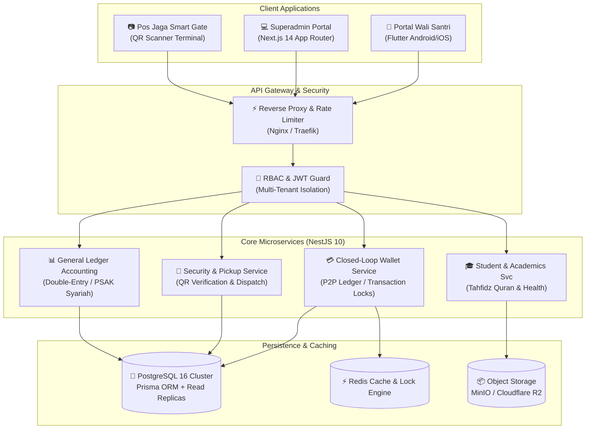

# 🕌 Koneksi Santri — Integrated Pesantren ERP & Mobile Ecosystem

> **Enterprise Management Platform & Mobile Ecosystem engineered for Islamic Boarding Schools (Pesantren).**  
> Featuring a cross-platform guardian mobile app (**Portal Wali Santri**), closed-loop cashless digital wallet, QR-code authorized smart gate security, and consolidated double-entry accounting ledger across multi-branch foundation entities.

[](https://admin.koneksisantri.tech)
[](LICENSE)
[](https://flutter.dev)
[](https://nestjs.com)
[](https://nextjs.org)
[](https://postgresql.org)

---

## 🚀 Live Showroom & Interactive Demo

Experience the live system directly without local installation:

- **Web Superadmin Portal:** [https://admin.koneksisantri.tech](https://admin.koneksisantri.tech)
- **Automated Sandbox Reset:** Production database state is automatically refreshed daily at `02:00 WIB`.
- **Pre-configured Role Switcher:** Quick role selection available directly on the login portal:
  - 🏫 **Pesantren Admin / Mudir** (Full governance, master data, permit approvals)
  - 💰 **Treasurer / Bendahara** (Tuition billing, cashflow ledger, balance reconciliation)
  - 🛡️ **Security Guard / Pos Jaga** (Smart Gate QR verification & student pickup clearance)
  - 👨‍👩‍👧 **Guardian / Wali Santri** (Student wallet top-up, daily pocket limit, permissions)
  - 🛒 **Canteen Cashier / Kasir** (Sub-second QR scan POS checkout with offline balance guard)

---

## 🏛️ System Architecture Overview



---

## 💡 Key Engineering Challenges & Solutions

### 1. Closed-Loop Digital Wallet (Fraud-Proof Canteen Transactions)
- **Challenge:** Eliminating cash leakage in pesantren while handling high-concurrency lunch rush transactions (thousands of students simultaneously buying at campus canteens).
- **Engineering Solution:**
  - Implemented an **append-only immutable transaction ledger** with pessimistic row-level locking on balance debit operations.
  - Configurable daily spending limit enforced at the database level to prevent student overspending.
  - Complete double-entry reconciliation between guardian top-ups, student pocket money balances, and canteen merchant payables.

### 2. QR Smart Gate Pickup Dispatch
- **Challenge:** Ensuring child safety when students are picked up for holidays or family leave without forged permits.
- **Engineering Solution:**
  - Dynamic time-sensitive encrypted QR tokens generated on the Flutter guardian app.
  - Security checkpoint terminal scans and verifies QR authenticity against active leave permissions in under 150ms.
  - Real-time WhatsApp and push notification alerts dispatched immediately upon gate exit.

### 3. Multi-Entity General Ledger Accounting
- **Challenge:** Managing consolidated finances across multiple pesantren branches, foundations, and educational units with independent budget allocations.
- **Engineering Solution:**
  - Normalized Chart of Accounts (COA) supporting multi-branch hierarchical trial balances.
  - Automated journal entries generated on every student billing settlement, inventory expense, and payroll disbursement.

---

## 🛠️ Technology Stack Breakdown

| Layer | Technologies & Tools |
| :--- | :--- |
| **Mobile Client** | Flutter 3.x, Dart, Riverpod / BLoC, Dio, Local Storage, Camera QR |
| **Web Superadmin** | Next.js 14 (App Router), TypeScript, Tailwind CSS, TanStack Query, Lucide Icons |
| **Backend Core** | NestJS 10, TypeScript, Prisma ORM, Class Validator, Passport JWT |
| **Database & Cache** | PostgreSQL 16 (Relational Ledger), Redis (Distributed Locks & Cache) |
| **Infrastructure** | Docker, Docker Compose, Nginx, CI/CD GitHub Actions |
| **Testing** | Jest (Unit & E2E Testing), Supertest |

---

## 🔒 Intellectual Property & Proprietary Notice

> **Notice:** The complete business engine, database seeders, private keys, and production deployment scripts of **Koneksi Santri** are proprietary intellectual property protected under exclusive copyright.

```text
Copyright (c) 2024-2026 Ahmad Ayub Nu'man. All Rights Reserved.
This project is proprietary and confidential. Unauthorized copying, reverse engineering, 
distribution, or commercial deployment is strictly prohibited.
```

For technical recruiter evaluations, partnership inquiries, or private codebase walkthroughs, please contact:
- **Engineer:** Ahmad Ayub Nu'man
- **Email:** [ayubnuman@gmail.com](mailto:ayubnuman@gmail.com)
- **Portfolio:** [https://portfolio-seven-theta-bovx80a70x.vercel.app](https://portfolio-seven-theta-bovx80a70x.vercel.app)
- **LinkedIn:** [https://www.linkedin.com/in/ayub-numan-871406155](https://www.linkedin.com/in/ayub-numan-871406155)
